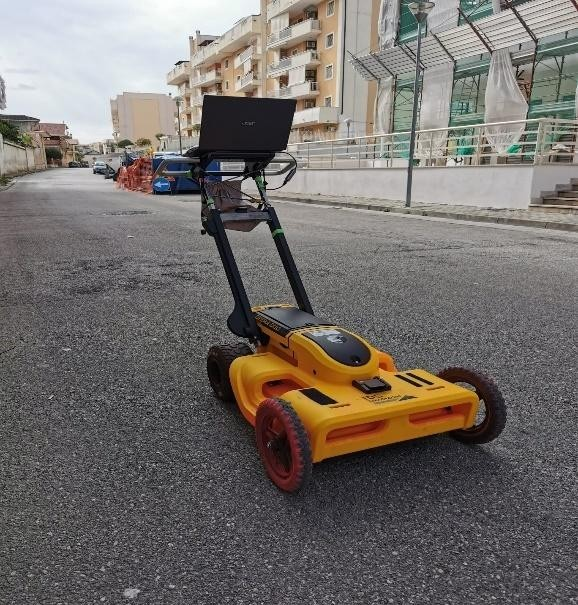
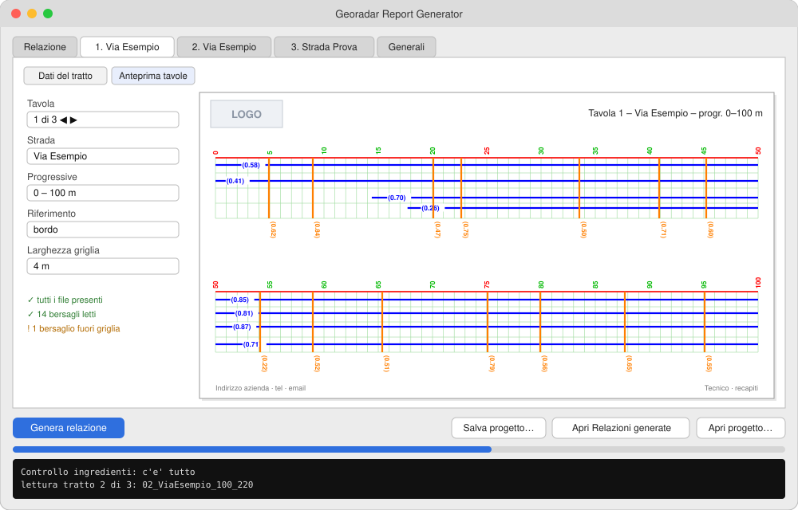
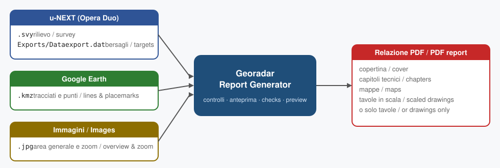

# Georadar Report Generator

**Dai dati del rilievo georadar alla relazione tecnica completa in PDF, in pochi minuti.**<br>
*From GPR survey data to a complete technical report in PDF, in minutes.*

[Italiano](#italiano) · [English](#english)

<p align="center"></p>
<p align="center"><sub>Schema dell'interfaccia con dati di esempio · Interface sketch with sample data</sub></p>
<br clear="right">

> Software disponibile **su richiesta**: gratuito per ricerca e didattica, con licenza per uso commerciale.
> Software available **on request**: free for research and education, licensed for commercial use.
> Contatti / Contact: **georadar.report.gen@icloud.com**

---

## Italiano

### Cosa fa
Georadar Report Generator trasforma i dati esportati da **IDS u-NEXT** (georadar Opera Duo) in una relazione
tecnica completa per indagini di ricerca sottoservizi. Sostituisce il passaggio manuale
u-NEXT → CAD → editor di testo.

La relazione comprende:
- copertina con dati della commessa e immagine dell'area;
- premessa con strade indagate e lunghezze;
- capitoli standard: attrezzature, strumento, metodologia, descrizione dei risultati;
- legenda;
- per ogni strada: pagina di dettaglio con area evidenziata e coordinate iniziali, pagina di zoom e
  **tavole in scala ogni 100 m** con sottoservizi longitudinali e trasversali e relative profondità misurate.

### Come funziona
<p align="center"></p>

| Serve | Da dove | Cosa fornisce |
|---|---|---|
| Rilievo `.svy` + `Exports/Dataexport.dat` | **u-NEXT** (georadar Opera Duo) | bersagli marcati: progressiva, posizione, profondità |
| Tracciati `.kmz` | **Google Earth** | percorso delle strade e coordinate di inizio/fine |
| Immagini `.jpg` | screenshot della mappa | area generale (copertina) e zoom per strada |

Una cartella per lavoro, una sottocartella per tratto: il nome del tratto (es. `01_ViaEsempio_0_100`)
indica strada e progressive.

```
Lavoro_Esempio/
├── 01_ViaEsempio_0_100/        ← .svy + Exports/Dataexport.dat
├── 02_ViaEsempio_100_220/
├── tracciati.kmz
└── 201_Lavoro_Esempio.jpg
```

1. **Apri lavoro** → una scheda per ogni tratto, dati letti in automatico.
2. **Controlla** dati e anteprima delle tavole; correggi se serve.
3. **Genera relazione** → PDF pronto in una cartella nuova.

### Punti di forza
- **Interfaccia grafica per operatori non tecnici**: si apre la cartella del lavoro, si controllano i dati,
  si preme *Genera*.
- **Solo valori misurati**: profondità e posizioni vengono dall'esportazione u-NEXT, mai stimate o ritoccate.
- **Controlli automatici** prima della generazione (file mancanti, bersagli fuori griglia, dati incoerenti),
  con avvisi in linguaggio semplice.
- **Lavori con più tratti**: i tratti consecutivi della stessa strada diventano un'unica strada in relazione.
- **Mappe automatiche**: tracciati letti dal KMZ, area dell'indagine evidenziata sull'immagine generale.
- **La tua azienda, la tua relazione**: logo (di qualsiasi dimensione, impaginato in automatico) e dati
  aziendali in intestazione e piè di pagina, dati del tecnico su ogni pagina.
- Modalità **Solo tavole**: solo le tavole in scala, senza pagine di testo.
- **Sicuro per costruzione**: le cartelle del rilievo non vengono mai modificate; ogni generazione crea una
  cartella nuova.
- **Tema chiaro e scuro**, schermi piccoli e ridimensionamento di Windows supportati.

### Piattaforme
- macOS (app) e Windows (exe), senza installazione.
- Da sorgente: Python 3.10+.

### Come averlo
Il software non è scaricabile pubblicamente. Scrivere a **georadar.report.gen@icloud.com** indicando:
- nome e organizzazione;
- uso previsto (commerciale / ricerca / didattica / studio);
- sistema operativo.

| Uso | Condizioni |
|---|---|
| **Commerciale** (imprese di indagini, studi tecnici, professionisti) | licenza su richiesta |
| **Ricerca e didattica** (università, ricercatori, studenti, sviluppatori software per studio o valutazione) | **gratuito**, uso non commerciale |

### Avvertenza
Destinato a operatori georadar formati. La relazione generata va verificata e firmata dal tecnico che la emette.

### Contributori
- Fabio Antonucci
- Jacopo Abete

---

## English

### What it does
Georadar Report Generator turns the data exported by **IDS u-NEXT** (Opera Duo ground-penetrating radar) into
a finished technical report for utility-detection surveys. It removes the manual
u-NEXT → CAD → word-processor workflow.

The report includes:
- cover page with job data and survey-area image;
- introduction with surveyed roads and lengths;
- standard chapters: equipment, instrument, methodology, description of results;
- legend;
- for each road: detail page with the highlighted area and start coordinates, a zoom page and
  **scaled drawings every 100 m** showing longitudinal and transverse utilities with their measured depths.

### How it works
<p align="center"></p>

| Input | Source | Provides |
|---|---|---|
| Survey `.svy` + `Exports/Dataexport.dat` | **u-NEXT** (Opera Duo GPR) | marked targets: chainage, position, depth |
| Lines `.kmz` | **Google Earth** | road paths and start/end coordinates |
| Images `.jpg` | map screenshots | overview (cover) and per-road zoom |

One folder per job, one subfolder per section: the section name (e.g. `01_ViaEsempio_0_100`) gives road
and chainage.

```
Example_Job/
├── 01_ViaEsempio_0_100/        ← .svy + Exports/Dataexport.dat
├── 02_ViaEsempio_100_220/
├── lines.kmz
└── 201_Example_Job.jpg
```

1. **Open job** → one tab per section, data read automatically.
2. **Check** data and drawing preview; correct if needed.
3. **Generate report** → PDF ready in a new folder.

### Highlights
- **Graphical interface for non-technical operators**: open the job folder, check the data, press *Generate*.
- **Measured values only**: depths and positions come from the u-NEXT export, never estimated or retouched.
- **Automatic checks** before generation (missing files, targets outside the grid, inconsistent data),
  with warnings in plain language.
- **Multi-section jobs**: continuous sections of the same road merge into one road in the report.
- **Automatic maps**: survey lines read from KMZ; survey area highlighted on the overview image.
- **Your company, your report**: logo (any size, laid out automatically) and company details in the
  page header and footer, surveyor details on every page.
- **Drawings only** mode: just the scaled drawings, without text pages.
- **Safe by design**: survey folders are never modified; every run creates a new output folder.
- **Light and dark mode**, small screens and Windows display scaling supported.

### Platforms
- macOS (app) and Windows (exe), no installation required.
- From source: Python 3.10+.

### Get it
The software is not publicly downloadable. Write to **georadar.report.gen@icloud.com** with:
- name and organisation;
- intended use (commercial / research / teaching / study);
- operating system.

| Use | Terms |
|---|---|
| **Commercial** (survey companies, engineering firms, professionals) | licence on request |
| **Research and education** (universities, researchers, students, software engineers for study or evaluation) | **free**, non-commercial use |

### Disclaimer
Intended for trained GPR operators. The generated report must be checked and signed by the technician
who issues it.

### Contributors
- Fabio Antonucci
- Jacopo Abete

---

u-NEXT and Opera Duo are trademarks of their respective owners. This project is not affiliated with IDS.
© 2026 Georadar Report Generator
